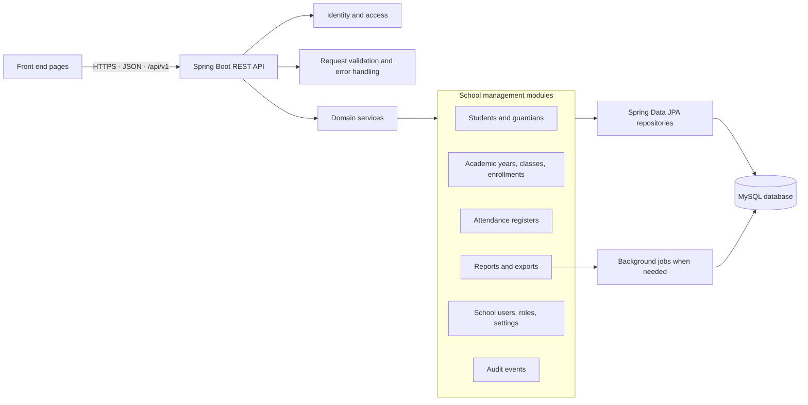
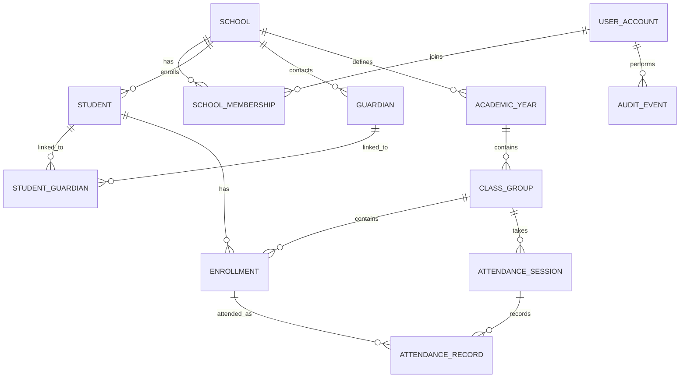

# Back End Architecture

> **Scope:** Server-side application and persistent data. A local Node.js JSON API is implemented in `backend/`; Spring Boot and MySQL remain the planned production architecture.

## Back end chart



## What belongs in the back end

| Area | Responsibility | Planned technology |
|---|---|---|
| API | Versioned JSON endpoints, request/response contracts, pagination | Spring Boot with Spring MVC, `/api/v1` |
| Identity and access | Sign-in/session lifecycle, user roles, school and record scope | Spring Security; secure server-managed sessions |
| Student records | Student profiles, guardian links, lifecycle state, enrollment history | Java domain services and MySQL tables |
| Academics | Academic years, year groups, classes, teacher assignments | Java domain services and MySQL tables |
| Attendance | Register sessions, present/absent/late/excused entries, corrections | Java domain services and MySQL tables |
| Reports | Authorized summaries and exports | API queries; background jobs for large exports |
| Persistence | Relational constraints, migrations, transactions | MySQL with Spring Data JPA/Hibernate and Flyway or Liquibase |
| Audit and operations | Record important changes, safe error responses, health and structured logs | Spring services and operational tooling |

## Initial domain model

These are the main records the first usable back end is expected to own. The detailed student-field list and final constraints should be written before implementing database migrations.



### Record ownership

- **School:** tenant boundary and school-level settings.
- **User account and membership:** staff identity, school membership, and assigned role. Authentication secrets belong to a trusted identity provider or secure credential service, not the browser.
- **Student:** school-owned profile and lifecycle status. Student numbers are unique within a school.
- **Guardian and student-guardian link:** guardian contact details and the relationship/permissions for each linked student. One student may have multiple guardians; one guardian may be linked to multiple students.
- **Academic year and class group:** school-year boundaries and classes scoped to the selected year.
- **Enrollment:** dated link between a student and a class, preserving class history when a student moves.
- **Attendance session and record:** one register per class and school date; one attendance result per enrollment in that register.
- **Audit event:** actor, action, affected record, timestamp, and request reference for important changes. Avoid copying full sensitive student records into audit metadata.

## API surface for the first release

Example endpoint groups (exact request/response fields are to be specified with the data model):

| Endpoint group | Example routes | Purpose |
|---|---|---|
| Session | `POST /api/v1/session`, `DELETE /api/v1/session` | Sign in and sign out |
| Students | `GET/POST /api/v1/students`, `GET/PATCH /api/v1/students/{id}` | Search, create, and update student profiles |
| Guardians | `GET/POST /api/v1/students/{id}/guardians` | Manage linked guardian contacts |
| Classes | `GET /api/v1/classes`, `GET /api/v1/classes/{id}/roster` | List classes and class rosters |
| Enrollments | `POST /api/v1/enrollments`, `PATCH /api/v1/enrollments/{id}` | Enroll or move a student while retaining history |
| Attendance | `GET/POST /api/v1/attendance/sessions`, `PATCH /api/v1/attendance/records/{id}` | Open registers and record/correct attendance |
| Reports | `GET /api/v1/reports/attendance` | Return authorized attendance summaries or create an export job |

## Back end rules

- Enforce authentication, role permissions, and school/record scope on every request. Never trust a submitted `schoolId` or a hidden front end control as authorization.
- Validate required fields, date ranges, relationships, and duplicate constraints in the service layer and database.
- Use transactions for multi-record operations such as enrollment changes and register submission.
- Return a consistent JSON error shape with a request ID; do not expose stack traces or SQL details.
- Keep personally identifiable student data out of logs, URLs, and analytics. Use synthetic records in development.
- Use schema migrations and backup/restore procedures for database changes.
- Keep large report exports asynchronous if they would make normal API requests slow.

## Implementation sequence

1. **Local prototype API complete:** persistent student CRUD, attendance register and settings endpoints, request validation, and health endpoint are in `backend/`.
2. Agree and document student, guardian, enrollment, class, and attendance fields and constraints.
3. Create the Spring Boot project, MySQL connection, migration setup, and shared error response.
4. Implement school membership and staff authorization before exposing student records.
5. Implement student, guardian, academic-year, class, and enrollment APIs.
6. Implement attendance sessions and records, including correction and audit behavior.
7. Connect the front end to the API, then add report queries and exports.

The local JSON backend has no authentication or school-level authorization and is intended for development with synthetic data only. See `backend/README.md` for setup and routes.

## Proposed server structure

```text
backend/src/main/java/.../school/
  common/       # errors, validation, pagination, request IDs
  identity/     # sessions, memberships, roles
  students/     # profiles and guardian links
  academics/    # academic years, classes, enrollments
  attendance/   # sessions and records
  reports/      # authorized queries and export jobs
  audit/        # change history
  infrastructure/ # persistence and external integrations
backend/src/main/resources/
  application.yml
  db/migration/ # versioned SQL migrations
```
