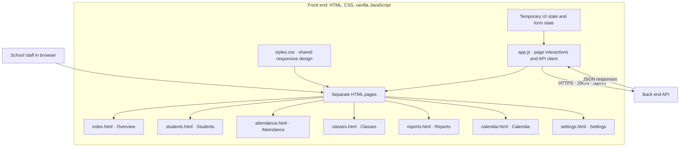

# Front End Architecture

> **Scope:** Browser application only. The student directory, attendance register, and school profile now use the local API when it is running; other pages remain prototype views.

## Front end chart



## What belongs in the front end

| Area | Responsibility | Current files |
|---|---|---|
| Pages | Render the distinct school workflows and their page content | `index.html`, `students.html`, `attendance.html`, `classes.html`, `reports.html`, `calendar.html`, `settings.html` |
| Shared presentation | Typography, color, responsive layout, navigation, tables, cards, forms, dialogs | `styles.css` |
| Interactions | Search, filters, menus, client-side validation, status controls, downloads, and API calls | `app.js` |
| User feedback | Loading, empty, success, and error messages shown in the interface | Page markup and `app.js` |
| Accessibility | Labels, keyboard support, focus states, readable contrast, and responsive controls | HTML and CSS |

### Page responsibilities

- **Overview:** school metrics, daily snapshot, attention list, student preview.
- **Students:** student directory, search/filter, student profile entry points, add/edit forms.
- **Attendance:** register entry, status changes, daily and weekly summaries.
- **Classes:** year groups, classes, rosters, teacher assignment entry points.
- **Reports:** available summaries, date filters, export requests and download status.
- **Calendar:** academic dates, school events, and event entry points.
- **Settings:** school profile, academic-year settings, and attendance conventions.

### Front end data rules

- The front end sends requests to the versioned API under `/api/v1` once the back end exists.
- Treat browser input as untrusted. The back end validates every field again and enforces permissions.
- Do not store credentials, sensitive student records, or authorization decisions in local storage.
- Use local state for temporary interface state. Keep server records in the API; local storage may be used only for low-risk preferences.
- Show clear loading, no-results, validation, and retry states for pages that load server data.
- Keep the shared navigation and page links consistent across every HTML page.

## Current versus planned

**Implemented now:** seven separate HTML pages, a shared responsive stylesheet, sample class/report content, basic page interactions, sample CSV downloads, and API integration for student listing/creation, attendance register reads/saves, and school profile reads/saves. Prototype interactions remain available when the API is offline.

**Planned:** sign-in, role-aware navigation, API-backed classes/calendar/reports, server-generated reports, and more complete loading/error states. The frontend API base defaults to `http://localhost:3000/api/v1` and can be changed with `window.FIELDNOTES_API_URL`.

## Front end structure

```text
index.html          # Overview
students.html       # Student directory
attendance.html     # Attendance register and summary
classes.html        # Class and year-group directory
reports.html        # Report library
calendar.html       # School calendar
settings.html       # School settings
styles.css          # Shared styles and responsive layouts
app.js              # Shared browser behavior and API client
```
